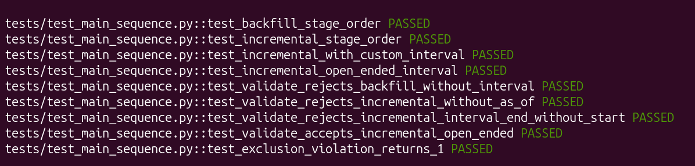
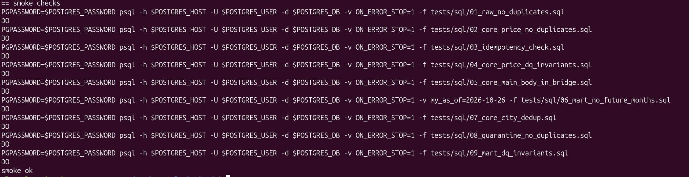

# Платформа аналитики и прогнозирования тарифов грузоперевозок (Smart Logistics Data & ML Platform)
_Тестовое задание: Middle Data Engineer._

_Дата выполнения:_ ноябрь 2026г.

_Использование ИИ:_ 
- Вопрос 3. ML Feature Engineering & Batch Inference тарифов (тк с ML ранее не работала);
- генерация er-диаграмм по ddl;
- генерация sequence-диаграмм по архитектурному проекту;
- генерация автотестов по критериям приёмки и коду.


## 1. Описание репозитория

| Путь | Описание |
|-----|-------------|
| [./docker/postgres/init/01_schema.sql](./docker/postgres/init/01_schema.sql) | ddl source-бд |
| [./docker/postgres/init/02_synthetic.sql](./docker/postgres/init/02_synthetic.sql) | скрипт заполнения source-бд синтетическими данными |
| [./docker/postgres/init/03_dwh_init.sql](./docker/postgres/init/03_dwh_init.sql) | ddl DWH |
| [.env.example](.env.example) | Переменные окружения (коннект к базе) |
| [./docs/architecture.md](./docs/architecture.md)| Архитектурный проект |
| [./docs/schemas/](./docs/schemas/)| ER-diagrams, sequence-diagrams |
| [./etl/loader_raw.py](./etl/loader_raw.py) | Реализация этапа source -> raw |
| [./etl/loader_core.py](./etl/loader_core.py) | Реализация этапа raw -> core |
| [./etl/loader_mart.py](./etl/loader_mart.py) | Реализация этапа core -> mart |
| [./ml/](./ml/) | Реализация ML |
| [./etl/main.py](./etl/main.py) | ETL flow |
| [./tests/test_main_sequence.py](./tests/test_main_sequence.py) | Тестирование ETL flow |
| [./tests/sql](./tests/sql) | Smoke-тесты выполнения бизнес-требований к состоянию бд |

## 2. Запуск контейнеров
```bash
cp .env.example .env
docker compose up --build -d
```
### Проверка результата

```bash
docker ps
#... STATUS  NAMES
#    Up      logistics-app
#    Up      logistics-postgres
```

После успешного запуска контейнеров поднимается бд postgres, содержащая по одной схеме на слой DWH (см [архитектура](./docs/architecture.md)).

Схема `public` содержит источник, заполненный синтетическими данными.

Остальные схемы содержат структуру слоев DWH.

```bash
docker compose exec postgres psql -U postgres -d deals_bigdata -c "\dn"
#      List of schemas
#  Name  | ... 
#--------+---
# core   | 
# dq     | 
# mart   | 
# public | 
# raw    | 
(5 rows)
```

## 3. Запуск автотестов

### pytest: проверка последовательности этапов ETL, валидация входных опций

```bash
docker compose exec app make test    
```

#### Ожидаемый результат


### smoke sql: проверки бизнес-правил, дедупликации, идемпотентности запусков
```bash
docker compose exec app make smoke   
```

#### Ожидаемый результат


## 4. Запуск вручную 

### Запуск ETL за весь период синтетич. данных
```bash
docker compose exec app python -m etl.main --run-type backfill --as-of 2026-10-26 \
    --interval-start 2023-03-01 --interval-end 2027-03-01
```

### Проверка результата

```bash
docker compose exec -T postgres psql -U postgres -d deals_bigdata <<'SQL'
SELECT 
  r.id run_id, r.status run_status, rs.stage_name, rs.status stage_status, 
  rs.rows_out, rows_quarantined, rs.details, rs.error_message
FROM dq.etl_runs r 
LEFT JOIN dq.etl_run_stages rs 
  ON r.id = rs.run_id
WHERE rs.run_id = (SELECT max(id) FROM dq.etl_runs) 
ORDER BY rs.id;
SQL
```

```bash
docker compose exec -T postgres psql -U postgres -d deals_bigdata <<'SQL'
SELECT 
  reason_code, count(*) 
FROM dq.quarantine_prices 
WHERE 
  run_id = (SELECT max(id) FROM dq.etl_runs) 
GROUP BY reason_code;
SQL
#
#    reason_code     | count 
#--------------------+-------
# price_non_positive |   164
# rate_missing       |    39

```

### Проверка витрины
```bash
docker compose exec -T postgres psql -U postgres -d deals_bigdata <<'SQL'
SELECT
    c1.name AS from_city,
    c2.name AS to_city,
    COALESCE(bg.name, 'Не указан') AS body_group,
    rc.weight_category,
    rc.month,
    rc.trips_count,
    rc.carriers_count,
    rc.median_trip,
    rc.median_km,
    rc.mom_pct,
    rc.reliability_level
FROM mart.route_card rc
JOIN core.city c1 ON c1.gc_id = rc.loading_city_gcid
JOIN core.city c2 ON c2.gc_id = rc.unloading_city_gcid
LEFT JOIN core.body_group bg ON bg.id = rc.body_group_id
WHERE rc.loading_city_gcid = 1001
  AND rc.unloading_city_gcid = 1003
ORDER BY rc.month DESC
LIMIT 5;
SQL
#
# from_city | to_city | body_group | weight_category |   month    | trips_count | carriers_count | median_trip | median_km | mom_pct | reliability_level 
#-----------+---------+------------+-----------------+------------+-------------+----------------+-------------+-----------+---------+-------------------
# Москва    | Казань  | Прочие     | OTH             | 2026-10-01 |           3 |              1 |    43275.36 |     48.24 |         | LOW_DATA
# Москва    | Казань  | Прочие     | G20T            | 2026-10-01 |           1 |              1 |    87850.39 |     97.94 |         | LOW_DATA
# Москва    | Казань  | Прочие     | FTL             | 2026-10-01 |           8 |              4 |    93951.69 |    104.74 |  -14.53 | LOW_DATA
# Москва    | Казань  | Прочие     | 10T             | 2026-10-01 |           1 |              0 |    82568.02 |     92.05 |         | LOW_DATA
# Москва    | Казань  | Борт       | OTH             | 2026-10-01 |           1 |              0 |    32100.38 |     35.79 |  -15.02 | LOW_DATA

```

### Инкрементальный запуск ETL 

```bash
docker compose exec app python -m etl.main --run-type incremental --as-of 2026-10-26
```
### Убедимся, что витрина не содержит месяцев, следующих за as-of
```bash
docker compose exec -T postgres psql -U postgres -d deals_bigdata <<'SQL'
SELECT 
  count(*) filter (where month <= date_trunc('month', '2026-10-26'::date)::date) cnt_lte_as_of, 
  count(*) filter (where month > date_trunc('month', '2026-10-26'::date)::date) cnt_gt_as_of  
  FROM mart.route_card;
SQL
# cnt_lte_as_of | cnt_gt_as_of 
#---------------+--------------
#        203644 |            0
```

## 5. [Архитектура решения (./docs/architecture.md)](./docs/architecture.md)
